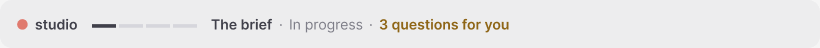
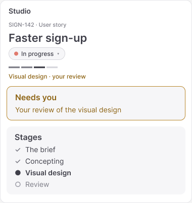
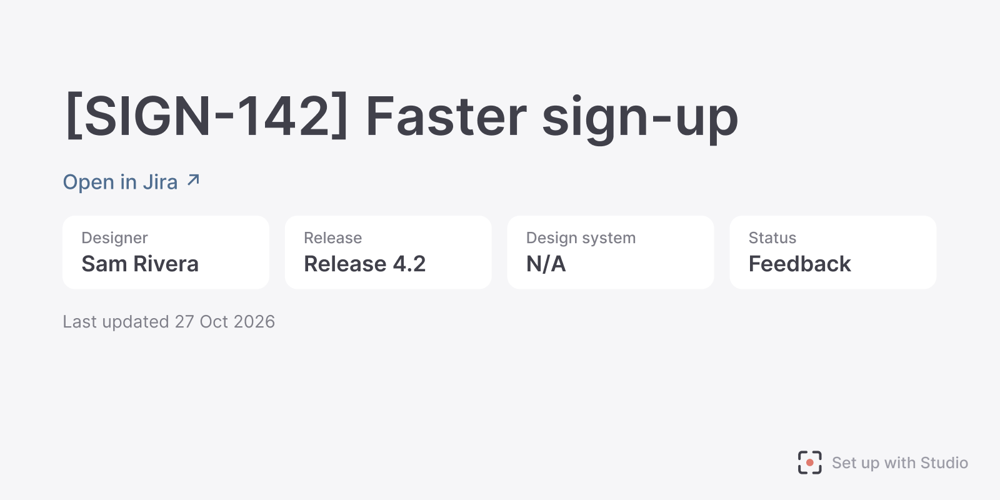
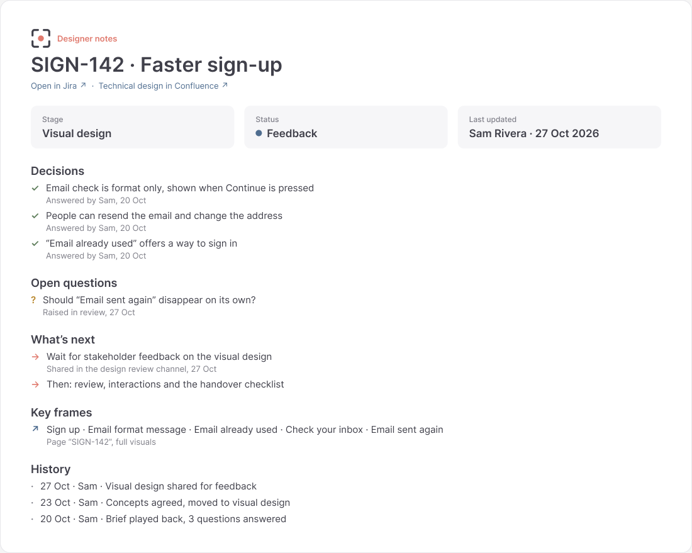

<p align="center">
  
</p>

<h1 align="center">Studio</h1>

<p align="center"><strong>Clearer, calmer Claude Code for designers</strong></p>

<p align="center">
  
  
  
</p>

<p align="center">
  <a href="#what-it-does">What it does</a> ·
  <a href="#how-a-project-moves">How a project moves</a> ·
  <a href="#install">Install</a> ·
  <a href="#commands">Commands</a> ·
  <a href="#how-your-work-stays-safe">Safety</a>
</p>

---

Studio is a plugin for [Claude Code](https://claude.com/claude-code) that makes Claude an extension of a designer. Paste a user story, and Claude builds the design **in your Figma file**, with **your design system**: wireframes and concepts first, then full visuals. It covers every path the story describes, keeps every screen consistent, checks the work and gets it ready for developers.

It speaks in plain words, and nothing changes without your say-so.

Studio is made for the **Code tab in the Claude app** first, and works in the terminal too.

## What it does

<table>
<tr>
<td width="50%" valign="top">

**Follows the story.** Reads the user story, plays the brief back in plain words and turns anything unclear into questions. It never fills a gap itself.

**Designs in Figma.** Builds with your design system's components, styles and variables only. If something's missing, it stops and asks.

**Shows where things are.** A band above where you type shows the stage and the project status. A panel beside the conversation follows the story, with what needs you first.

</td>
<td width="50%" valign="top">

**Sets every project up the same way.** An optional template adds a Cover, User story, Concept, Final design and Designer notes page, with the cover as the file's thumbnail.

**Passes work on.** "Leave notes for the team" keeps a Designer notes page up to date, so a colleague, or cover for annual leave, can say "pick up SIGN-142" and carry on.

**Keeps you in charge.** Claude asks before changing a Figma file, never touches the design system, and never changes anything in Jira or Confluence.

</td>
</tr>
</table>

<p align="center">
  
</p>

<p align="center">
  
</p>

## How a project moves

Work moves through four **stages**, like a designer's own workflow:

| Stage | What happens |
|---|---|
| **1 · The brief** | Claude reads the user story (and its technical design, if you add it), plays it back with every path it describes, and asks about anything unclear. You choose the Figma file, whether to use a branch, and where to start. |
| **2 · Concepting** | Wireframes and concepts in Figma, to explore directions. |
| **3 · Visual design** | Full visuals with your design system. Each change you ask for is made once and carried across every screen it affects. |
| **4 · Review** | Checked against the story and the design system, with notes in Figma where something doesn't match. Interactions made clear for developers, and a handover checklist. |

The **project status** is yours to set: **Not started**, **In progress**, **Feedback** or **Ready for dev**. Change it from the panel, or just say it. Claude can suggest a change, but never makes it.

No user story? Just describe what you'd like to do, and Claude starts at the stage that fits.

## Every project, the same shape

<p align="center">
  
</p>

The project template is offered once, at the end of the brief. It adds five pages before any already in the file, sets every page's canvas to your team's colour (#F5F5F5 by default), builds the cover and writes the User story page from the story, with nothing invented. Your team's logo can sit on a charcoal strip across the top of the cover.

## Picking up where someone left off

<p align="center">
  
</p>

The **Designer notes** page says where the project stands: decisions, open questions, what's next, key frames and history. Claude updates it only when you say yes, and Studio offers to when you set the status to Feedback or Ready for dev. Whoever picks the project up says "pick up SIGN-142", and Claude reads the notes without changing anything, fills in the panel and plays back where it's at.

## Install

You'll need:

- **Claude Code** 2.1.287 or later, in the Claude app's Code tab or the terminal
- **The official Figma plugin**, signed in to your work Figma account

In a terminal:

```bash
claude plugin install figma@claude-plugins-official
```

```bash
claude plugin marketplace add andy-jp-wilson/studio
```

```bash
claude plugin install studio@studio-local
```

Then restart the Claude app (or type `/reload-plugins`) and run `/setup`. It's a short chat: Figma connected, the right account, which design system and which Figma file.

**Setting up a team?** Studio only needs a few shared settings: your design systems, and optionally your logo and canvas colour. The first person adds them in `/setup` and saves a small team file for everyone else. See [the team setup guide](plugin/team/studio-team-setup.md).

## Commands

You never need one; just ask in your own words.

| Command | What it does |
|---|---|
| `/setup` | Connect Figma, check the account, choose the design system and the Figma file |
| `/guide` | How Studio works, in plain words |
| `/glossary` | What words mean |
| `/panel` | Open the Studio panel |
| `/version` | Which Studio you have, and update it if there's a newer one |

## How your work stays safe

- **Design system files are never changed.** Studio refuses any change to them, even if asked.
- **Nothing changes in Figma without your say-so.** Before Claude's first change to a file in a conversation, Studio asks in plain words.
- **Jira and Confluence are read only.** Claude reads user stories and technical designs, and never changes anything there.
- **Work stays on your computer.** Nothing is uploaded (sent to GitHub or anywhere online) unless you ask, and Studio checks where it's going first.
- **Undo is always close.** Figma's own undo and version history for Figma work; "go back" for files on your computer.

## What's in this repository

| Folder | What's in it |
|---|---|
| [`plugin/`](plugin/) | Studio itself: Claude's instructions, the band and panel, the skills, the protections and the tests |
| [`plans/`](plans/) | How Studio was planned and built, phase by phase |
| [`docs/`](docs/) | The pictures in this page |

Studio is designed in Figma before it's built. The examples here use a made-up user story, SIGN-142 "Faster sign-up".

---

<p align="center"><sub>Made by Andrew Wilson, with Claude.</sub></p>
